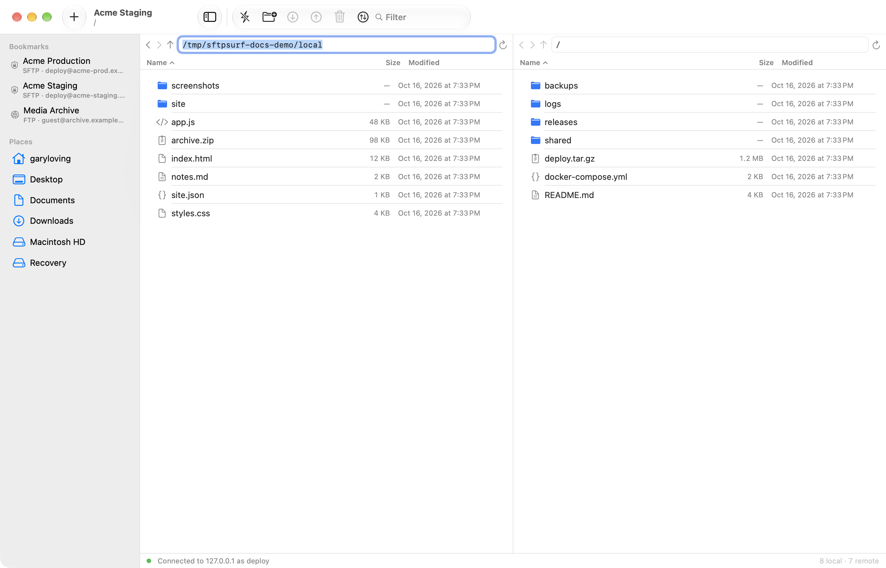
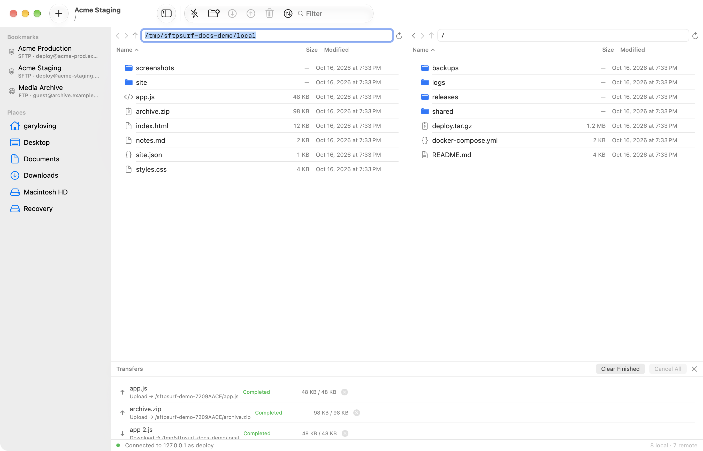

# SFTPsurf

A two-pane SFTP and FTP browser for macOS. Local files on the left, the server
on the right, drag between them. No donate prompts, no nag screens, no account.



Transfers run in a queue with per-file progress, live throughput and a cancel
button:



## Requirements

macOS 14 or later, plus the Swift toolchain. This machine builds with the
Command Line Tools alone — Xcode is **not** required:

```sh
xcode-select --install     # if you do not already have the tools
```

## Build and run

```sh
./Scripts/bundle.sh release     # builds dist/SFTPsurf.app
open dist/SFTPsurf.app
```

`dist/SFTPsurf.app` is a normal app bundle you can drag to `/Applications`.
It is ad-hoc signed, which is fine for local use.

### Installer disk image

```sh
./Scripts/make-dmg.sh          # dist/SFTPsurf-<version>.dmg
```

Produces a drag-to-install image: the app on the left, an arrow, an Applications
alias on the right, over a generated background. The layout is applied to a
read-write image with Finder, then compressed — that order matters, because
Finder stores the icon arrangement in `.DS_Store` on the mounted volume. Icon
placement needs Automation permission for Finder; if that is unavailable the
script says so and still builds a working (just unplaced) image.

The script reads the version out of `Info.plist`, so the filename cannot drift
from the app inside it, and then mounts the finished image to confirm the
executable, the alias, the background, the saved layout and the code signature
are all present before reporting success.

For a quick iteration loop you can also run it straight from the source tree:

```sh
swift run SFTPsurf
```

## Features

**Browsing**
- Two panes, side by side: local on the left, remote on the right.
- Each pane has back / forward / up, an editable path field, and reload.
- Click any column header to sort; the choice is remembered.
- Toolbar filter box narrows both listings as you type.
- Hidden files are hidden by default, in both panes. Toggle in Settings.
- Sidebar of saved connections plus Home, Desktop, Documents, Downloads and
  mounted volumes.

**Transfers**
- Drag files between panes, or use the toolbar / menu.
- Folders transfer recursively in both directions.
- A queue runs up to 3 transfers at once (configurable), with per-file progress,
  live throughput and a cancel button.
- Dropping onto an existing name never clobbers it: the usual "name 2" pattern
  is used, like Finder.

**Connections**
- SFTP, driven by macOS's own `/usr/bin/ssh`, so every key type OpenSSH supports
  works: ed25519, RSA, ECDSA, FIDO tokens, `ssh-agent`, `ProxyJump`, and the
  contents of `~/.ssh/config`.
- Password, private key file, or agent / default keys.
- FTP with passive mode, UTF-8 filenames, `MLSD` where available and a tested
  fallback to classic `LIST` parsing.
- Host keys are pinned trust-on-first-use in SFTPsurf's own known-hosts file,
  seeded once from `~/.ssh/known_hosts`. A *changed* key is still a hard failure.
- Bookmarks and preferences as JSON in
  `~/Library/Application Support/SFTPsurf/`; passwords in the login keychain.

**Scripts**

| Script | Purpose |
|---|---|
| `Scripts/bundle.sh` | Build `dist/SFTPsurf.app` |
| `Scripts/make-dmg.sh` | Build the drag-to-install `.dmg` |
| `Scripts/test.sh` | Run the test suite |
| `Scripts/setup-test-deps.sh` | One-off venv with `pyftpdlib` |
| `Scripts/screenshot.sh` | Real screenshots of the running app |
| `Scripts/capture-ui.sh` | Screenshots without Screen Recording permission |
| `Scripts/make-icon.swift` | Regenerate `Resources/AppIcon.icns` |
| `Scripts/make-dmg-background.swift` | Draw the disk image background |

**Keys**

| Action | Shortcut |
|---|---|
| New connection | ⌘N |
| Connect / disconnect | ⌘K / ⇧⌘K |
| Refresh | ⌘R |
| New remote / local folder | ⇧⌘N / ⌥⌘N |
| Upload selection | ⇧⌘U |
| Download selection | ⇧⌘D |
| Delete remote selection | ⌘⌫ |
| Show transfer queue | ⇧⌘T |

Double-click a folder to open it; double-click a file to download and open it.

## How it works

```
Sources/
├── SFTPsurfCore/     protocol clients and file plumbing (no UI)
│   ├── Remote/       the RemoteFileClient protocol both clients implement
│   ├── SFTP/         SSH subprocess + SFTP v3 packet layer
│   ├── FTP/          control connection, passive data connections, parsing
│   ├── Local/        local filesystem access
│   ├── Transfer/     the transfer queue and scheduler
│   ├── Persistence/  bookmarks, preferences, keychain, app paths
│   └── Support/      byte streams, socket and process transports
├── SFTPsurfUI/       SwiftUI views, the browser model, launch config
├── SFTPsurf/         the app entry point and scripted-launch driver
└── SelfTest/         the test suite
```

Two design decisions are worth calling out.

**SFTP runs through `/usr/bin/ssh`.** A pure-Swift SSH stack cannot do RSA keys,
key files in PEM form, or `ssh-agent`, and reimplementing those means
reimplementing OpenSSH. Instead SFTPsurf asks `ssh` for the `sftp` subsystem and
speaks the SFTP packet protocol itself, so transfers still report precise
per-file progress. This is why every key type works.

**FTP serialises everything.** FTP carries all commands over one control
connection, so a second transfer running concurrently with the first crosses
their `PASV` replies and completion codes. `FTPClient` therefore hands out
exclusive use of the control connection around each data transfer. The transfer
queue can still be asked for three at a time; the client simply queues them.

## Tests

```sh
./Scripts/setup-test-deps.sh    # once: venv with pyftpdlib
./Scripts/test.sh
```

The suite runs against real servers rather than mocks:

- **SFTP** is tested against macOS's own `/usr/libexec/sftp-server`, which speaks
  the same wire protocol as a remote OpenSSH server. This covers the whole
  packet layer without needing a live `sshd`.
- **FTP** is tested against a real `pyftpdlib` server booted on a random port,
  including a run with `MLSD` disabled to exercise the `LIST` parser.

102 checks cover listing, metadata, rename, permissions, recursive transfers,
byte-for-byte round trips, the transfer scheduler, the stores, path helpers,
both FTP listing parsers, the subprocess transports, and the scripted-launch
config parser.

### Testing against a real server

The two suites above cover the protocols, but not the `ssh` invocation,
authentication, or a remote host's quirks. To close that gap, point the suite at
a saved bookmark and it will run a second set of checks over a genuine SSH
connection — connect, make a directory, upload, list, download, rename,
permissions, deletes — verifying bytes come back identical:

```sh
SFTPsurf_REAL_HOST=<bookmark-uuid> ./Scripts/test.sh
```

The bookmark's password is read from the keychain by the same code the UI uses,
so no credential is ever passed on a command line. Everything happens inside a
uniquely named scratch folder that is removed afterwards, including on failure.

List bookmark ids with:

```sh
python3 -c "import json,pathlib;print(*[b['id'] for b in json.loads((pathlib.Path.home()/'Library/Application Support/SFTPsurf/bookmarks.json').read_text())], sep='\n')"
```

Note that this machine's toolchain has neither XCTest nor a SwiftPM-compatible
swift-testing overlay, so `SelfTest` is a small executable target instead of a
`swift test` target. `Scripts/test.sh` is the entry point and exits non-zero on
failure, so it drops straight into a pre-commit hook.

## Screenshots

The images above are generated, not hand-captured, so they cannot drift from the
app:

```sh
./Scripts/make-docs-screenshots.sh      # writes docs/screenshots/
```

That script builds a throwaway tree of generic files, serves the "remote" pane
from a local `pyftpdlib` instance, redirects bookmarks to a scratch directory so
your own are never read, uses only RFC 2606 reserved hostnames, and pins the
appearance to light so the output does not depend on your theme. Nothing in the
committed images refers to a real machine. It needs Screen Recording permission,
because it uses `screencapture`.

For capturing *your own* session instead — useful when filing a bug report — use
`Scripts/screenshot.sh <bookmark-uuid>`, which connects to a saved bookmark and
captures the window.

`Scripts/capture-ui.sh` is a third option that needs no special permission at
all, because the app rasterises its own window. It is the fallback if Screen
Recording is unavailable; note that AppKit's translucent sidebar does not
rasterise that way, so the sidebar comes out blank.

## Known limitations

- No FTPS or WebDAV; FTP is plain, SFTP is the secure option.
- No resumed transfers: an interrupted transfer starts again.
- Remote-to-remote moves use rename, which is instant on the same server, but
  there is no server-side copy between two different servers.
- No in-place file editing.
- Permissions can be set through `SFTPClient.setPermissions` /
  `FTPClient.setPermissions` (via `SITE CHMOD`) but no UI exposes it yet.
- SFTP relies on `/usr/bin/ssh`, so it is macOS-only by design. The SSH key
  material is whatever OpenSSH can already read: PEM and RSA keys work, as do
  `ssh-agent` and hardware tokens.
- The app is ad-hoc signed and the disk image is not notarised. It runs fine on
  the machine that built it, but on another Mac Gatekeeper reports an
  unidentified developer; the recipient can right-click the app and choose Open,
  or clear the quarantine flag. Shipping it without that warning needs a paid
  Apple Developer ID certificate and a `notarytool` submission, which is a
  code-signing decision rather than a code change.

## Contributing

See [CONTRIBUTING.md](CONTRIBUTING.md), and [CHANGELOG.md](CHANGELOG.md) for what
changed in each release. Bug reports are much easier to act on
with the server software and the error text; the issue template asks for both.

## Security

Please report vulnerabilities privately rather than in a public issue. See
[SECURITY.md](SECURITY.md), which also describes exactly how SFTPsurf handles
passwords, keys and host keys — worth reading before trusting it with a server.

## License

[MIT](LICENSE) © 2026 Gary Loving.

